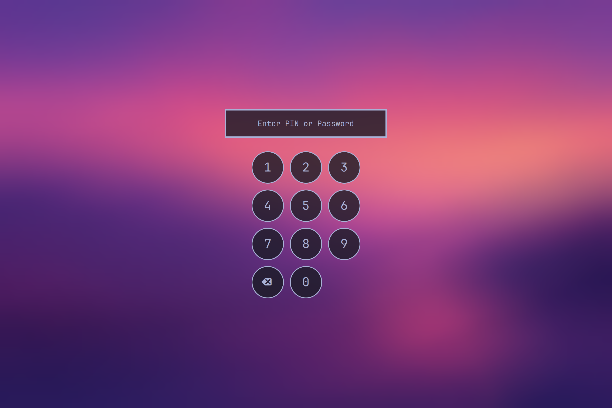

# Lock Screen PIN Pad for Omarchy

Listed on the [Omarchy plugin marketplace](https://plugins.omarchy.org/plugin.html?id=io.github.yeutterg.lock-pin).

Omarchy's lock screen plus an on-screen number pad and an optional 4–6 digit
PIN. Made for tablets and detachables: with the keyboard off there's no way to
type a password, and the on-screen keyboard can't draw over a session lock.



- Tap the PIN; it unlocks as soon as the last digit matches. Your password
  still works, typed on a hardware keyboard.
- After 5 wrong PINs the PIN stops working until the next password unlock.
- The pad shows whenever a PIN is set (default), or only while the keyboard is
  detached (`lock-pin keypad detached`).
- Everything else is Omarchy's stock lock screen: password through PAM,
  fingerprint, blurred wallpaper. It replaces the built-in `omarchy.lock`
  while enabled.

## Install

```bash
omarchy plugin add https://github.com/yeutterg/omarchy-lock-pin --enable
omarchy restart shell
```

Then set a PIN in a terminal (it asks twice and never echoes it):

```bash
~/.config/omarchy/plugins/io.github.yeutterg.lock-pin/lock-pin set
```

Without a PIN the lock screen behaves exactly like Omarchy's.

## The PIN

```
lock-pin set                     choose a 4-6 digit PIN
lock-pin remove                  turn the PIN off
lock-pin keypad always|detached  when the pad shows
lock-pin status                  JSON status
```

Only a salted SHA-512 crypt hash (`openssl passwd -6`) is stored, in
`~/.local/state/omarchy-lock-pin/` with user-only permissions. The PIN is
checked by that script, outside PAM; the password path is Omarchy's own PAM
service (`omarchy-lock-password`). A PIN is weaker than a password: use it
where the convenience is worth it.

## Remove

```bash
omarchy plugin remove io.github.yeutterg.lock-pin
omarchy restart shell
```

Omarchy's lock screen comes back. Delete `~/.local/state/omarchy-lock-pin` to
drop the stored PIN hash.

## How it works

- `Service.qml` and `LockView.qml` are Omarchy's lock plugin (Quattro) with the
  number pad and PIN check added. As a clone of `omarchy.lock` it keeps the
  lock's IPC (`omarchy-shell lock ...`) and keybinds.
- Detached mode comes from the kernel's tablet-mode switch: the plugin finds
  devices reporting `SW_TABLET_MODE` in `/proc/bus/input/devices` and adds
  Hyprland switch binds at runtime with `hyprctl eval` (`omarchy-shell lock
  setTabletMode true|false`). Nothing in your Hyprland config is changed.
- `omarchy-shell lock preview` shows the lock screen without locking.

## Keeping up with Omarchy

The lock screen is a copy of Omarchy's. After Omarchy updates its lock plugin,
this copy may need the same changes; if it ever fails to load, run
`omarchy plugin enable omarchy.lock` to get the stock lock back.

## License

MIT. `Service.qml` and `LockView.qml` are derived from Omarchy's lock screen
(MIT, Copyright (c) David Heinemeier Hansson); that notice is kept in
`LICENSE`.
